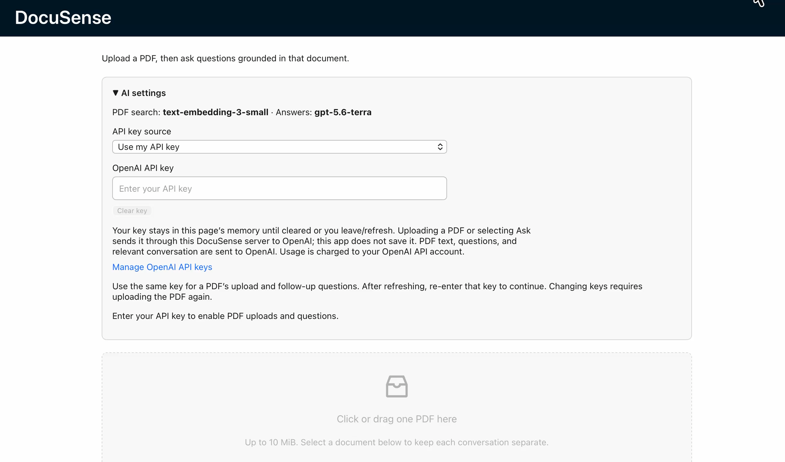

# DocuSense

A PDF question-answering application built with React, Ant Design, Express, LangChain and OpenAI. Upload a text PDF, ask follow-up questions, and inspect the retrieved excerpts and their original page numbers.

[Demo](#demo) · [Features](#what-works) · [Run locally](#local-setup) · [API setup](#using-a-personal-api-key)



## Demo

[▶ Watch the DocuSense demo](https://drive.google.com/file/d/1Zq19IsJ1KP_Tukoe9ms7PuynsdLYulZF/view?usp=sharing)

A recorded walkthrough of the locally running application.

## What works

- Per-document PDF parsing, overlapping text chunks and cached in-memory embeddings. Questions reuse the document index.
- Session-isolated documents and conversation context; document selection, duplicate-upload reuse and deletion.
- Retrieval of up to four excerpts, page references and up to six completed conversation turns for follow-ups.
- Optional browser voice input and answer playback. Typed questions work without speech support.
- Bounded PDF workers, upload limits, cancellation, timeouts, capacity limits and controlled API errors.
- Optional temporary personal API keys, with separate credential scopes for cached PDF indexes.

## Local setup

Use **Node.js 24 LTS** and npm. Run these commands from this repository's root:

```sh
npm ci
npm --prefix server ci
cp server/.env.example server/.env
```

Edit `server/.env` and choose a key setup: set `OPENAI_API_KEY` for a server-managed key, or set `ALLOW_USER_API_KEYS=true` to enable the personal-key input in **AI settings**. Keep this file private. Never put an API key in build-time frontend configuration. Document text is sent to OpenAI to create embeddings; questions, retrieved excerpts and limited conversation history are sent to generate answers.

```sh
npm run dev
```

Open `http://localhost:3000`. The development proxy forwards `/api` requests to `http://127.0.0.1:5001`. If either process fails, stop the development command, resolve the reported error and run it again.

Without either key source, the page still loads but uploading and asking questions remain disabled. The application does not fabricate model answers.

## How the API is used

1. **Upload and index:** Extract text from the PDF, split it into overlapping chunks, and send those chunks to the OpenAI Embeddings API. Cache the resulting vectors for that document.
2. **Ask and follow up:** Embed the question, retrieve relevant chunks, then call Chat Completions with those excerpts and recent conversation. Return the answer together with the actual retrieved text and page numbers.

The defaults are `text-embedding-3-small` for search and `gpt-5.6-terra` for answers. Voice input and answer playback use optional browser speech features, not a separate OpenAI speech API.

## Using a personal API key

With `ALLOW_USER_API_KEYS=true`, open **AI settings → Use my API key** and enter your OpenAI API key. Uploading a PDF or pressing **Ask** sends that key to this DocuSense server, which calls OpenAI. Both operations can consume your API account's quota; typing a key does not make a provider request.

The key stays in the current page's React state and request-local backend provider. It is not saved to browser storage, cookies, the document index, files, or logs. Clear it with **Clear key**; leaving or refreshing the page also discards it. After refreshing, re-enter the same key to continue with an indexed PDF. Keys are not included in list/delete requests.

Each PDF index is bound to its key source and a keyed, non-reversible credential fingerprint. Using a different key/source for that PDF returns a readable conflict instead of silently using another account. Re-upload with the new key to create a separate index; duplicate uploads reuse the cache only when the document session and credential scope match. Models remain server-configured to preserve embedding compatibility.

Personal keys are disabled by default. Enable them only on a server you trust, with HTTPS for hosted use; localhost previews can use HTTP. Requests use a fixed OpenAI endpoint and reject redirects. A valid key needs access and quota for both configured models.

## Configuration

| Setting | Location | Default |
| --- | --- | --- |
| `OPENAI_API_KEY` | Server only | Required for the server-managed key option |
| `ALLOW_USER_API_KEYS` | Server only | `false`; enables temporary personal keys when `true` |
| `OPENAI_CHAT_MODEL` | Server only | `gpt-5.6-terra` |
| `OPENAI_EMBEDDING_MODEL` | Server only | `text-embedding-3-small` |
| `PORT`, `HOST` | Server only | `5001`, `127.0.0.1` |
| `CORS_ORIGINS` | Server only | Local frontend and API origins in the example |
| `REACT_APP_API_BASE` | Optional root `.env` | `/api` |
| `API_PROXY_TARGET` | Optional root `.env`, development only | `http://127.0.0.1:5001` |

The original GPT-3.5 Turbo integration has been replaced: [OpenAI lists GPT-3.5 Turbo as shut down](https://developers.openai.com/api/docs/models/gpt-3.5-turbo). The default model is configurable; [GPT-5.6 Terra supports Chat Completions](https://developers.openai.com/api/docs/models/gpt-5.6-terra). Provider calls use the server's native fetch adapter rather than the old LangChain OpenAI client.

To serve a production frontend and API from one local address:

```sh
npm run build
npm run server
```

Open `http://localhost:5001`. Include your actual browser origin in `CORS_ORIGINS` when changing ports or deployment URLs.

## Docker option

After creating `server/.env`:

```sh
docker compose up --build
```

Open `http://localhost:5001`. The compose port is bound to the local computer. The Docker configuration is provided but has not been executed in this workspace.

## Data lifecycle and limits

PDF text, vectors and conversation context are held **only in server memory**. The uploaded binary PDF is not saved to disk. All session data disappears on restart or after 30 idle minutes. The tab keeps only a random session capability and selected document ID in `sessionStorage`; page refresh restores available documents, while visible chat cards remain in page memory. Do not share the session capability.

Each session supports three documents; one PDF may be at most 10 MiB, 100 pages, 300,000 extracted characters and 500 chunks. There are at most 20 sessions, 30 documents and two concurrent indexing operations per instance. Questions are limited to 2,000 Unicode characters. Paid operations have an instance-wide burst limit of 12 and refill one slot every five seconds. Text extraction runs in a disposable worker with a 20-second deadline. Image-only scanned PDFs require external OCR; password-protected PDFs are not supported.

This is a portfolio/local application with random document sessions, rather than an account system. An internet-facing multi-user deployment also needs account access controls, HTTPS and deployment-specific quotas. In-memory indexes are not shared across instances. PDF text is treated as untrusted context, but generated answers and model-written citations still need human checking; the displayed excerpts are the actual retrieved sources.

## Verification

```sh
npm test -- --watchAll=false --runInBand
npm --prefix server test
CI=true npm run build
```

Automated tests use synthetic PDFs and local fake model responses. Integration tests exercise the real PDF worker, LangChain vector store, HTTP routes and OpenAI adapter against a local mock upstream. No real OpenAI request, account key or private uploaded PDF is used in these tests. Docker has not been tested in this workspace.

Verified on 2026-11-05 after adding personal keys: 35 frontend tests and 45 backend tests passed, and the strict production build succeeded. Checks cover credential-scoped index reuse, mismatched-key rejection, request-local provider credentials, missing-key protection, and the existing PDF/conversation flows. Live account permissions, quotas and answer quality are not covered by these automated tests. The author-recorded local demo is linked above.

Frontend details: [FRONTEND.md](FRONTEND.md). API contract: [server/README.md](server/README.md). Repair notes: [修复说明.zh-CN.md](修复说明.zh-CN.md).
